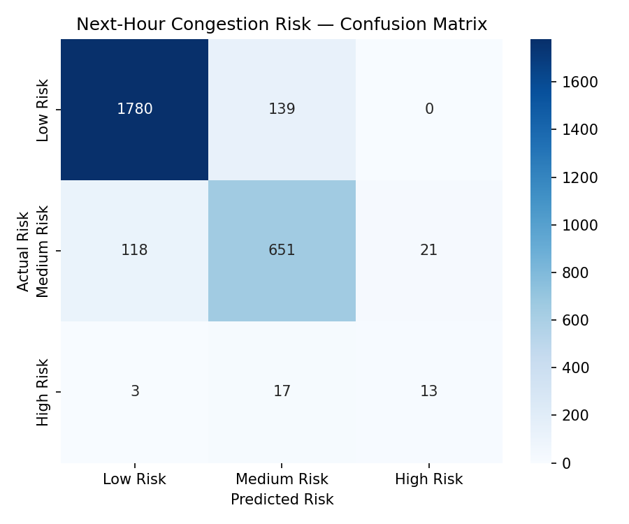
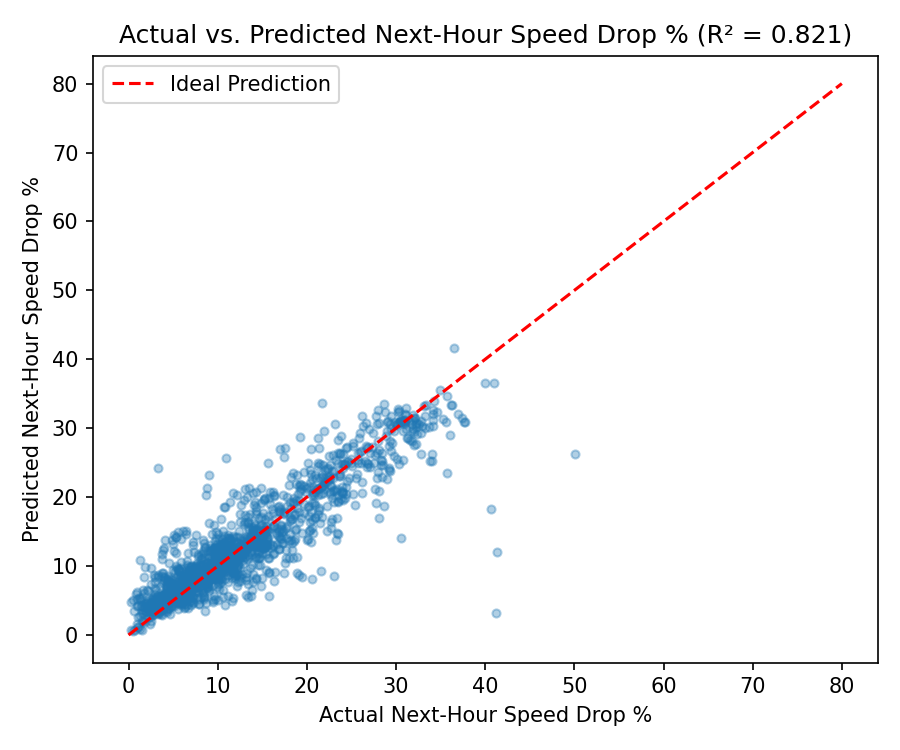
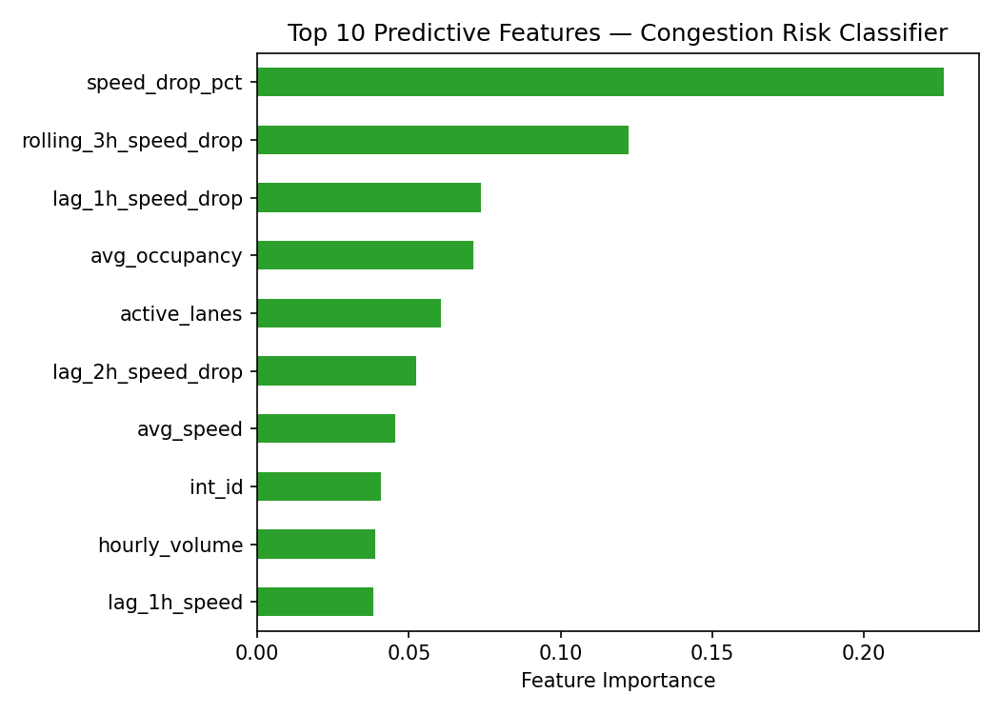
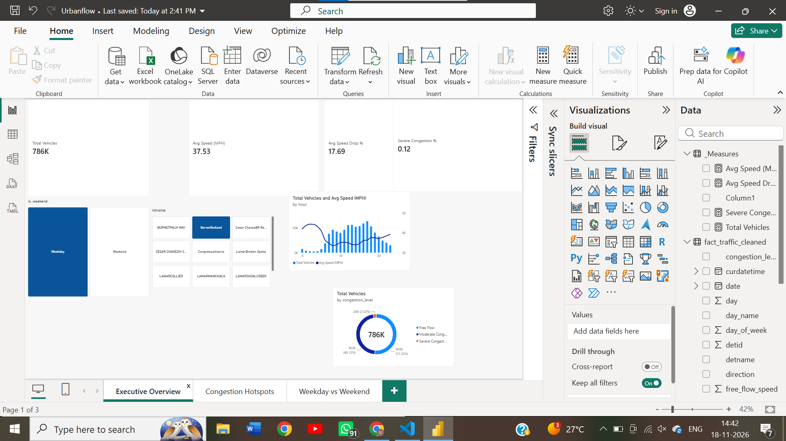
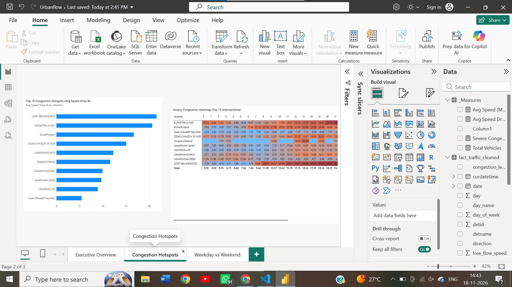
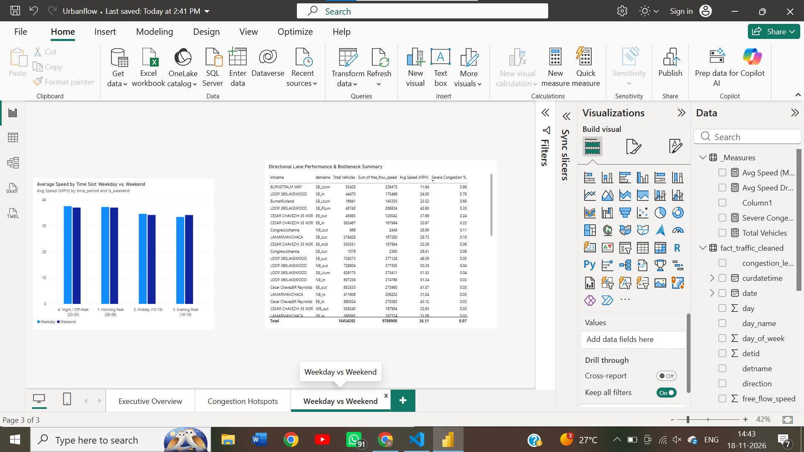
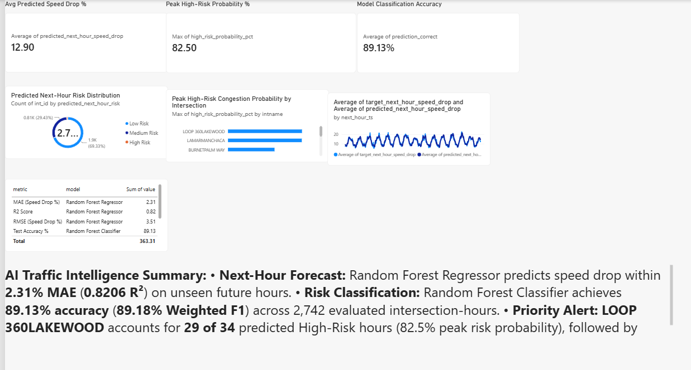

# UrbanFlow – Smart City Traffic Pattern & Congestion Intelligence

End-to-end **Data Analytics & Machine Learning** platform built on **236,364** real-world radar telemetry records (**16,458,874** observed vehicles) from the City of Austin Open Data portal (`2021-06-01` to `2021-08-08`). UrbanFlow transforms raw 15-minute lane sensor readings into congestion KPIs, relational SQL insights, next-hour Random Forest congestion forecasts, and an interactive 4-page Power BI intelligence dashboard.

---

## Architecture & Pipeline

1. **Data Engineering (`notebooks/run_pipeline.py`):** Cleans raw radar sensor telemetry, removes malformed/out-of-bounds readings, calculates intersection-specific **85th-percentile Free-Flow Speeds**, and derives **Speed Drop %** and congestion severity tiers (`Free Flow`, `Moderate Congestion`, `Severe Congestion`).
2. **Relational SQL Analytics (`sql/urbanflow_analysis.sql` & `notebooks/run_sql.py`):** Executes 8 structured SQL queries (`Q0`–`Q7`) on SQLite (`urbanflow.db`) using `HAVING`, `CASE WHEN`, CTEs, and rolling 3-hour `AVG() OVER` / `RANK() OVER` window functions.
3. **Predictive Machine Learning (`notebooks/train_congestion_model.py`):** Aggregates 15-minute lane data into **13,675** consecutive hourly intersection records, engineers lag (`t-1h`, `t-2h`) and rolling 3-hour historical features, enforces a strict **80/20 chronological split** (`10,933` train / `2,742` test hours) to prevent data leakage, and trains both a **Random Forest Regressor** and a class-balanced **Random Forest Classifier** saved via `joblib`.
4. **Interactive Power BI Dashboard (`dashboard/Urbanflow.pbix`):** 4-page executive and AI analytics report powered by custom DAX measures (`_Measures`) and ML forecast outputs.

---

## Key SQL & Traffic Findings (`Q0`–`Q5`)

* **Network Scale (`Q0`):** `236,364` cleaned 15-minute records across `10` Austin intersections totaling `16,458,874` vehicles.
* **Top Congestion Hotspots (`Q1`):**
  * **LOOP 360LAKEWOOD:** `2,777,465` vehicles | `47.0 MPH` actual vs. `59.0 MPH` free-flow (**21.6% avg speed drop**).
  * **BURNETPALM WAY:** `1,218,871` vehicles | `36.0 MPH` actual vs. `45.0 MPH` free-flow (**20.7% avg speed drop**).
  * **BurnetRutland:** `1,010,995` vehicles | `38.0 MPH` actual vs. `45.0 MPH` free-flow (**16.7% avg speed drop**).
* **Peak Rush Hour (`Q2` & `Q3`):** Network congestion peaks during the **Weekday Evening Peak (16:00–19:00)** at `17:00` (`1,194,748` vehicles, `33.4 MPH` avg speed, `19.3%` speed drop, and `10.05%` severe congestion share).
* **Directional Bottlenecks (`Q4`):** `BURNETPALM WAY` (`SB_Lturn`, `74.1%` speed drop) and `LOOP 360LAKEWOOD` (`SB_in`, `60.7%` speed drop) represent the sharpest turn-pocket and corridor bottlenecks.

---

## Machine Learning Evaluation (`Q6`–`Q7`)

Evaluated strictly on unseen future telemetry (`2021-07-25 02:00 UTC` onward, `2,742` intersection-hours):

| Model | Target | Metric | Score |
| :--- | :--- | :--- | :--- |
| **Random Forest Regressor** | Next-Hour `speed_drop_pct` (`t+1h`) | MAE / RMSE / $R^2$ | **2.31%** / **3.51%** / **0.8206** |
| **Random Forest Classifier** | Next-Hour Risk (`Low` / `Medium` / `High`) | Accuracy / Weighted F1 | **89.13%** / **89.18%** |

* **High-Risk Hotspot Detection (`Q6`):** **LOOP 360LAKEWOOD** accounts for **29** predicted High-Risk hours and **201** Medium-Risk hours (`82.5%` peak high-risk probability; `19.91%` actual vs. `20.04%` predicted speed drop), followed by **LAMARMANCHACA** (`4` High-Risk hours, `82.3%` peak probability).
* **Intersection Accuracy (`Q7`):** Reaches **96.30%** classification accuracy (`1.01%` MAE) at `LAMARSHOALCREEK` and **87.46%** at `LOOP 360LAKEWOOD`.

### Model Diagnostic Plots




---

## Power BI Dashboard Previews

### Page 1: Executive Traffic Overview


### Page 2: Congestion Hotspots & Hourly Matrix


### Page 3: Weekday vs. Weekend & Lane Flow


### Page 4: AI Traffic Intelligence


---

## How to Reproduce

```bash
pip install -r requirements.txt
python notebooks/run_pipeline.py
python notebooks/train_congestion_model.py
python notebooks/run_sql.py
